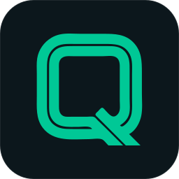

# Maximiliano Roca

**Inspector de Calidad que programa las herramientas que usa en planta**

---

### 👋 Sobre mí

Trabajo en control de calidad de planta. Lo que veo todos los días son planillas en papel,
Excel que se pasan en limpio al final del turno e informes que se arman a mano. Por eso
estudio desarrollo de software: para convertir esas tareas en apps simples que se usan
**desde el celular o la tablet, en la línea, con guantes y aunque no haya señal**.

Todas mis apps forman la suite **QualityOS**: una misma forma de trabajar y una misma identidad
visual, cada una enfocada en una tarea concreta de calidad.

---

### ⭐ Proyecto destacado: QualityOS · Control de lotes

Control de calidad de lotes de punta a punta: **control en línea** pallet por pallet (peso por
pico, identificación, inducción con semáforo, QR, packaging y paletizado), **control final** y
**dictamen** con registro de quién lo firmó. Es la primera app que hice y el origen de la suite:
la reconstruí desde cero sobre **Supabase**.

 

- **Multiempresa**: cada empresa ve solo sus datos, con roles (Inspector de Calidad, Coordinación,
  Administración) que hace cumplir la propia base de datos.
- **Sin señal primero**: carga todo en la tablet y sincroniza cuando vuelve la conexión, sin
  pisar cambios de otros equipos.
- **Auditoría** de cada versión de cada lote y **registro imprimible** en A4.

[Ver el repositorio](https://github.com/roca-byte/qualityos) · [Abrir la app](https://roca-byte.github.io/qualityos/) (acceso por invitación)

---

### 📂 La suite QualityOS

| App | Qué resuelve | Stack | Demo |
|-----|--------------|-------|------|
| [**qualityos**](https://github.com/roca-byte/qualityos) | Control de lotes: control en línea por pallet, control final y dictamen, multiempresa y sin señal | HTML · CSS · JS · PWA · Supabase | [Abrir](https://roca-byte.github.io/qualityos/) |
| [**controlLinea**](https://github.com/roca-byte/controlLinea) | Recorridas de control en líneas de envasado y control final de lotes, con reporte gráfico del día en PDF | HTML · CSS · JS · PWA | [Abrir](https://roca-byte.github.io/controlLinea/) |
| [**mash-check**](https://github.com/roca-byte/mash-check) | Planillas de Seguridad e Higiene (botiquines, tableros eléctricos, absorbentes) con constructor de planillas propias | HTML · CSS · JS · PWA | [Abrir](https://roca-byte.github.io/mash-check/) |
| [**informeCalidad**](https://github.com/roca-byte/informeCalidad) | Informe de Estado de Planta desde el celular: desvíos con fotos, acción correctiva y PDF listo para enviar | HTML · CSS · JS · PWA | [Abrir](https://roca-byte.github.io/informeCalidad/) |
| [**calidad-no-conformidades**](https://github.com/roca-byte/calidad-no-conformidades) | Registro mensual de No Conformidades tipo planilla, con KPIs, severidad sugerida, plazos y exportación a Excel | HTML · CSS · JS · PWA | [Abrir](https://roca-byte.github.io/calidad-no-conformidades/) |
| [**causa-raiz**](https://github.com/roca-byte/causa-raiz) | Análisis de causa raíz de un problema: Ishikawa 6M, 5 por qué, plan de acción, verificación de eficacia y Pareto | HTML · CSS · JS · PWA | [Abrir](https://roca-byte.github.io/causa-raiz/) |

---

### 🛠️ Cómo construyo

- **Hecho para la planta:** botones de al menos 48 px, pocos campos por pantalla y lenguaje
  de todos los días.
- **Funciona sin conexión:** todas las apps son PWA instalables que abren sin señal.
- **Simple a propósito:** HTML, CSS y JavaScript puros, sin frameworks ni build. Cualquiera
  puede abrir el código y entenderlo.
- **Reglas separadas de la pantalla:** en QualityOS y en Análisis Causa Raíz las reglas de
  negocio tienen pruebas automáticas (y en QualityOS, también los permisos).
- **Misma identidad:** teal profundo `#0F5C6E`, verde acento `#00A884`, modo claro u oscuro
  según el sistema y la misma barra superior con la marca **Q**.

---

### 🎓 Formación

- **Tecnicatura Universitaria en Desarrollo de Software** · Universidad Provincial de Ezeiza (UPE) · *en curso, 1er año*
- **Diplomatura en Gestión Integral de la Calidad** · UTN FRRe · *en curso, finaliza en noviembre de 2026*
- **Diplomatura en Programación Web Full Stack IA Assisted** · UTN FRRe · *en curso*
- **Técnico en Informática** · Escuela Técnica N°1 de Quilmes · 2019

---

### 🧰 Herramientas y conocimientos

- **Programación:** C (en aprendizaje), HTML, CSS, JavaScript
- **Herramientas:** Git, GitHub, GitHub Pages, Supabase (Postgres, RLS), VS Code
- **Calidad:** ISO 9001, No Conformidades, acciones correctivas, análisis de causa raíz (Ishikawa, 5 por qué, Pareto), control en línea, informes de desvíos, KPIs de calidad

---

### 📫 Contacto

- 📧 [maxyroca7@gmail.com](mailto:maxyroca7@gmail.com)
- 💼 [LinkedIn](https://www.linkedin.com/in/maximiliano-roca-120b69235)
- 🐙 [github.com/roca-byte](https://github.com/roca-byte)

**QualityOS** · Hecho para resolver problemas reales de planta

