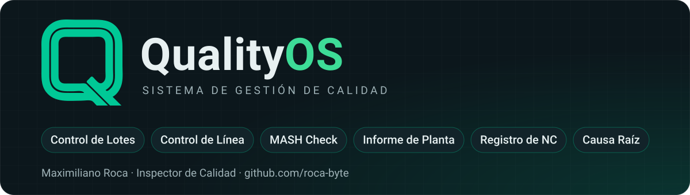

# Maximiliano Roca

**QualityOS · Herramientas simples para calidad en planta**

---

### Qué hago

Trabajo en control de calidad de planta y uso la programación para digitalizar tareas que antes se hacían en papel o en Excel y Word: recorridas de línea, registro de desvíos, no conformidades e informes para gestión.

Todas mis apps comparten **QualityOS**, una misma identidad visual: teal profundo, componentes simples, botones grandes para usar con guantes y funcionamiento sin conexión.

---

### 📂 Proyectos

| Proyecto | Qué resuelve | Stack | Demo |
|----------|--------------|-------|------|
| [**controlLinea**](https://github.com/roca-byte/controlLinea) | Recorridas de control en líneas de envasado y control final de lotes, con reporte gráfico del día exportable a PDF | HTML · CSS · JS · PWA | [Abrir](https://roca-byte.github.io/controlLinea/) |
| [**mash-check**](https://github.com/roca-byte/mash-check) | Planillas de Seguridad e Higiene (botiquines, tableros eléctricos, absorbentes) con constructor de planillas propias | HTML · CSS · JS · PWA | [Abrir](https://roca-byte.github.io/mash-check/) |
| [**informeCalidad**](https://github.com/roca-byte/informeCalidad) | Informe de Estado de Planta desde el celular: desvíos con fotos, acción correctiva y PDF listo para enviar | HTML · CSS · JS · PWA | [Abrir](https://roca-byte.github.io/informeCalidad/) |
| [**calidad-no-conformidades**](https://github.com/roca-byte/calidad-no-conformidades) | Registro mensual de No Conformidades tipo planilla, con KPIs, severidad sugerida, plazos y exportación a Excel | HTML · CSS · JS · PWA | [Abrir](https://roca-byte.github.io/calidad-no-conformidades/) |

---

### 🎨 Identidad visual

La base compartida de **QualityOS**:

| Token | Valor | Uso |
|-------|-------|-----|
| Teal profundo | `#0F5C6E` | Barra superior, botones principales, títulos |
| Verde acento | `#00A884` | Marca, indicadores positivos y foco |
| Fondo claro | `#EEF3F3` | Fondo general en modo claro |
| Tinta | `#12262D` | Texto principal |
| Tipografía | Segoe UI / system-ui | Interfaz legible en celular y escritorio |
| Radios | 10–14 px | Botones, tarjetas y campos |
| Toque mínimo | 48 px | Botones cómodos para usar con guantes |

Las apps respetan el modo claro/oscuro del sistema y usan la misma barra superior con la marca **Q**.

---

### 🎓 Formación

- **Tecnicatura Universitaria en Desarrollo de Software** · Universidad Provincial de Ezeiza (UPE) · *en curso, 1er año*
- **Diplomatura en Gestión Integral de la Calidad** · UTN FRR · *en curso, finaliza en noviembre de 2026*
- **Diplomatura en Programación Web Full Stack IA Assisted** · UTN FRR · *en curso*
- **Técnico en Informática** · Escuela Técnica N°1 de Quilmes · 2019

---

### 🧰 Herramientas y conocimientos

- **Programación:** C (en aprendizaje), HTML, CSS, JavaScript
- **Herramientas:** Git, GitHub, GitHub Pages, VS Code
- **Calidad:** ISO 9001, No Conformidades, acciones correctivas, control en línea, informes de desvíos, KPIs de calidad

---

### 📫 Contacto

- 📧 [maxyroca7@gmail.com](mailto:maxyroca7@gmail.com)
- 💼 [LinkedIn](https://www.linkedin.com/in/maximiliano-roca-120b69235)
- 🐙 [github.com/roca-byte](https://github.com/roca-byte)

**QualityOS** · Hecho para resolver problemas reales de planta

